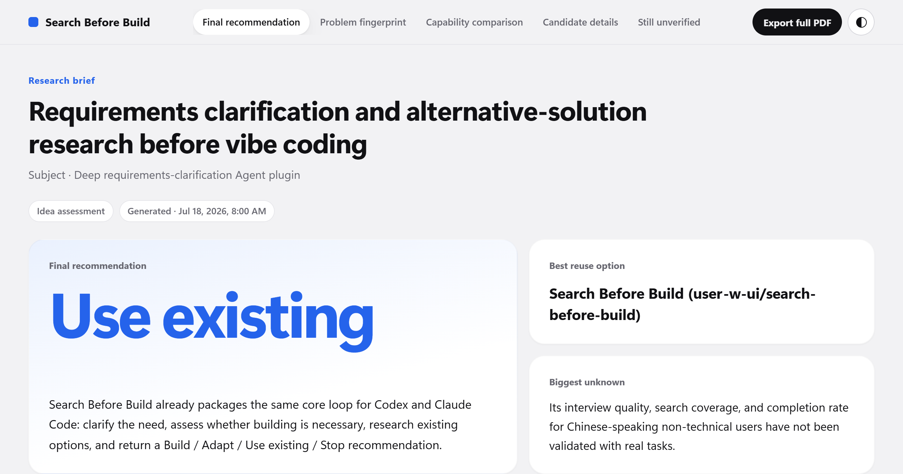
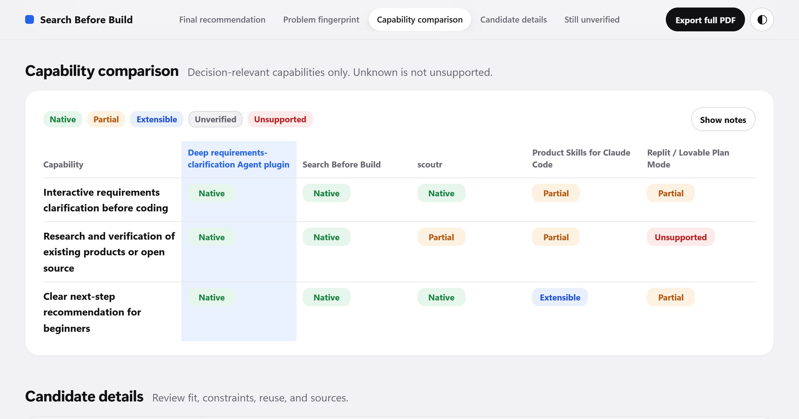
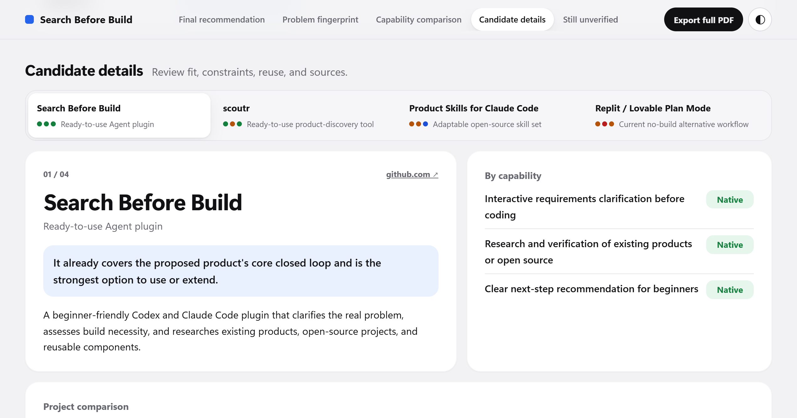
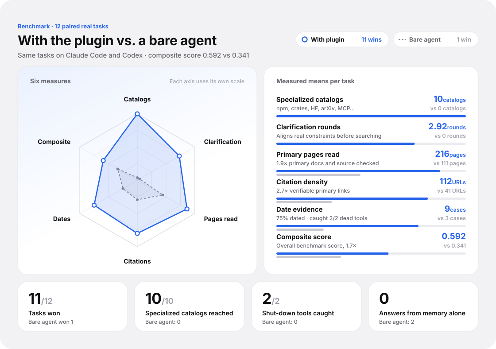

<div align="center">


# Search Before Build

**Before you start vibe coding, make sure the idea is actually worth building.**

A pre-build research plugin for Claude Code, Codex, OpenCode, and other agents that load skills: clarify your real needs, discover and aggregate similar projects and alternatives across platforms, and get a clear recommendation before you start building—use an existing tool, adapt a close match, or build from scratch.

[](https://www.npmjs.com/package/@superq/search-before-build)


[](./LICENSE)

[English](./README.md) | [简体中文](./README.zh-CN.md)

</div>

---

## Why does this exist?

Vibe coding has made the distance between “I have an idea” and “I’m writing code” incredibly short. That feels great, but it also makes it easy to build an entire system for a one-off problem, discover a mature product halfway through, reinvent the wheel, or spend a huge number of tokens on a project you will never use.

`search-before-build` is not here to discourage ideas. It simply asks you to pause for a few minutes before starting and answer three questions:

1. **What are you actually trying to solve?**
2. **Does this really need to be built?**
3. **Is there an existing solution you can use or adapt?**

## How does it work?

```text
A vague idea
     │
     ▼
Clarify the real problem ──→ Decide whether it is worth building ──→ Find and verify existing solutions
                                                                                  │
                                                                                  ▼
                                                             Build / Adapt / Use existing / Stop
```

It ends with a clear recommendation that you remain free to override:

| Recommendation | Meaning |
| --- | --- |
| **Build** | The need is real, and existing solutions do not cover the critical gap |
| **Adapt** | A close solution already exists, and modifying it makes more sense than starting from scratch |
| **Use existing** | A mature solution already addresses the main problem, so using it is the better trade-off |
| **Stop** | Evidence for the need is weak, or the cost of building clearly outweighs the benefit |

## Two skills

| Skill | Best for | What it does |
| --- | --- | --- |
| `assess` | Deciding whether to build an idea, or whether to keep building an existing plan, prototype, or repository | Reads whatever you supply first (repository, docs, screenshots), asks only about what is still missing (one question at a time, up to five), confirms its understanding, then researches and recommends a direction with a full brief |
| `quick-search` | A fast "does something like this already exist?" check | Asks nothing unless it must, checks a few relevant sources, and answers in the chat with up to five candidates and a clearly marked preliminary view |

```text
/search-before-build:assess I want to build a tool that automatically organizes saved content
/search-before-build:assess ./docs/plan.md
/search-before-build:quick-search a CLI that converts OpenAPI specs to TypeScript clients
```
## More than GitHub search

The plugin first determines what it needs to find, then chooses where to look. It extracts a functional fingerprint from your needs and searches only relevant sources instead of scanning every platform every time.

| What you are looking for | Preferred source |
| --- | --- |
| Open-source repositories, source code, or reusable implementations | GitHub |
| JavaScript / Node.js dependencies, CLIs, or plugins | npm |
| Python libraries or tools (exact package names) | PyPI |
| Cross-ecosystem package metadata and maintenance signals | Ecosyste.ms Packages |
| MCP tools or connectors for agents | Official MCP Registry |
| JVM dependencies (Java / Kotlin / Android) | Maven Central |
| Rust crates | crates.io |
| Models, datasets, or reusable AI applications | Hugging Face Hub |
| Algorithms, papers, or academic precedents | arXiv |

For SaaS products, commercial tools, app-store listings, and other solutions outside those catalogs, it supplements the research with web search and official product pages. When the target market is unclear, it searches in both Chinese and English. Stars and download counts help assess maturity, but never replace functional matching, and similar names alone are not treated as evidence that two products compete.

### Optional in-depth GitHub search

If a GitHub MCP server, connector, or equivalent tool is available, the plugin reuses it. Otherwise, it can still work through public APIs and web search. On Claude Code and Codex, `assess` can install GitHub’s official MCP server automatically with your consent:

```text
Enable in-depth GitHub search
```

The installer downloads and verifies the official binary, then runs it with the `repos` toolset in `--read-only` mode. Sign-in uses browser-based OAuth that requests no extra permission scopes; no PAT, Docker, or extra package is required. If you previously authorized the GitHub MCP Server with broader permissions, GitHub may reuse them; revoke it at github.com/settings/applications to reset. The server runs read-only either way. GitHub keeps that sign-in in memory only, so each new Agent session briefly opens GitHub in the browser on its first search; after the first approval this usually needs no extra clicks.

## Temporary research brief and optional saving

After research, `assess` renders a polished local HTML brief containing the final recommendation, search coverage, capability matrix, strongest candidates, reusable lessons, and unknowns. The page is a self-contained offline file with no CDN dependency. It is written to the OS temporary directory, so a casual question does not leave reports in the current project.

### Read a research brief in three steps

[Explore a live report](https://user-w-ui.github.io/search-before-build/)

**1. Start with the decision**

Turn the real need, strongest evidence, and remaining unknowns into one clear recommendation before development begins.

[](./assets/showcase/en/01-decision.png)

**2. Inspect the capability matrix**

Compare only decision-relevant capabilities with consistent support labels. Missing evidence stays unverified instead of becoming unsupported.

[](./assets/showcase/en/02-capability-matrix.png)

**3. Examine each candidate**

Review adoption cost, material constraints, reusable designs, and traceable primary sources for every strong candidate.

[](./assets/showcase/en/03-competitor-analysis.png)

Every competitor has **Save Markdown** and **Copy Markdown** actions. A long-lived report is created only when you choose to export it after reviewing the result, or explicitly ask the plugin to persist a selected competitor:

```text
docs/search-before-build/<current-project>/<competitor>.md
```

Persisted reports remain one file per competitor and contain only the overview, comparison with the current project, notable designs, reusable lessons, one-sentence summary, and sources. They exclude the necessity check and final verdict.

## Installation and usage

**Let your agent install it**

Send this to the agent you use (Claude Code, Codex, OpenCode, Pi, and others):

```text
Read https://raw.githubusercontent.com/user-w-ui/search-before-build/main/INSTALL.md and follow it to install Search Before Build.
```

Or install it yourself:

**Codex (one command)**

```bash
npx @superq/search-before-build install
```


**Codex (development install, tracks `main`)**

```bash
codex plugin marketplace add user-w-ui/search-before-build --ref main
codex plugin add search-before-build@search-before-build
```

**Claude Code (marketplace)**

```text
/plugin marketplace add user-w-ui/search-before-build
/plugin install search-before-build@search-before-build
```

After installation, use `/search-before-build:assess` or `/search-before-build:quick-search`. Update it with `/plugin marketplace update search-before-build`.

**OpenCode (v2 or later)**

```bash
opencode plugin add github:user-w-ui/search-before-build
```

OpenCode attaches skills with `@` rather than `/`, for example `@search-before-build-assess I want to build a tool that automatically organizes saved content`.

**Pi**

```bash
pi install git:github.com/user-w-ui/search-before-build
```

**Cursor, GitHub Copilot, VS Code, and other Agent Plugins clients**

The repository root carries an [Agent Plugins](https://agent-plugins.org) `plugin.json`, so clients that support the format can install the repository directly.

Automatic GitHub MCP installation is available only on Claude Code and Codex; on other hosts the skills reuse any GitHub tool you already have, or fall back to public APIs and web search.

**Validate the plugin**

```bash
npm test
npm run benchmark:offline
claude plugin validate --strict .
python tests/validate_plugin.py
```

## Benchmark

We ran a paired, real-scenario comparison: 12 tasks (9 "should I build this" ideas + 3 evaluations of existing projects), each executed twice — once with a bare agent, once with the plugin loaded — across Claude Code and Codex. Full data and methodology: [`bench/results/SUMMARY.md`](./bench/results/SUMMARY.md).

<div align="center">



</div>


## Acknowledgements

- [WebVector](https://github.com/rthomas24/web-vector) — design reference for the retrieval pipeline and rank fusion
- [pi-web-access](https://github.com/nicobailon/pi-web-access) — an early example of packaging web access for a coding agent

## Contributing

Issues and pull requests are welcome, especially for commonly overlooked search platforms, false matches between similarly named but functionally different products, reuse cases that save meaningful time or tokens, and wording that is still too difficult for non-technical users.

---

<div align="center">

### Think twice. Build once.

</div>
