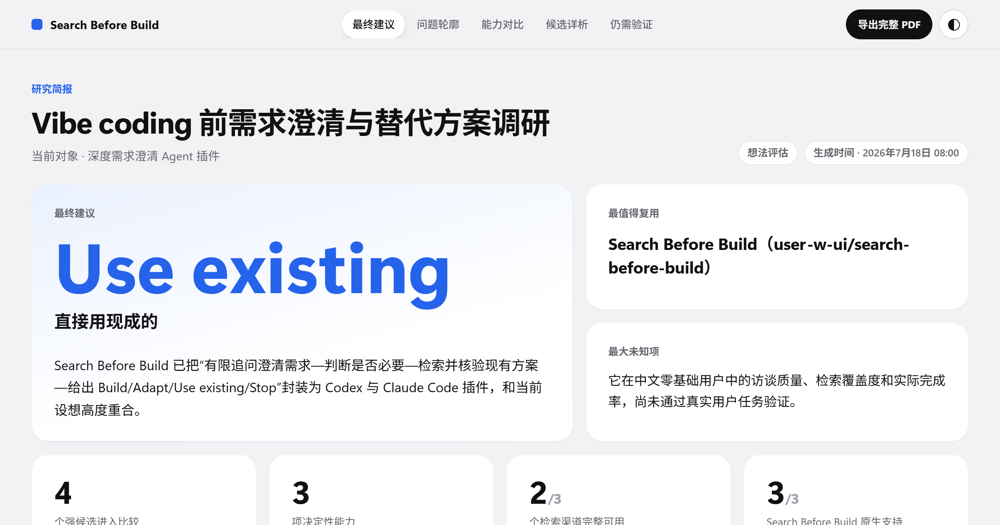
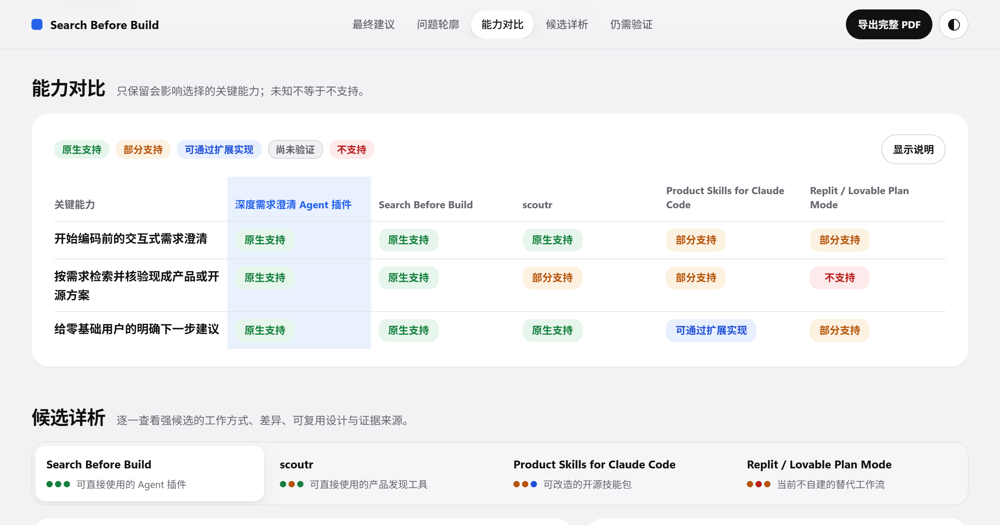
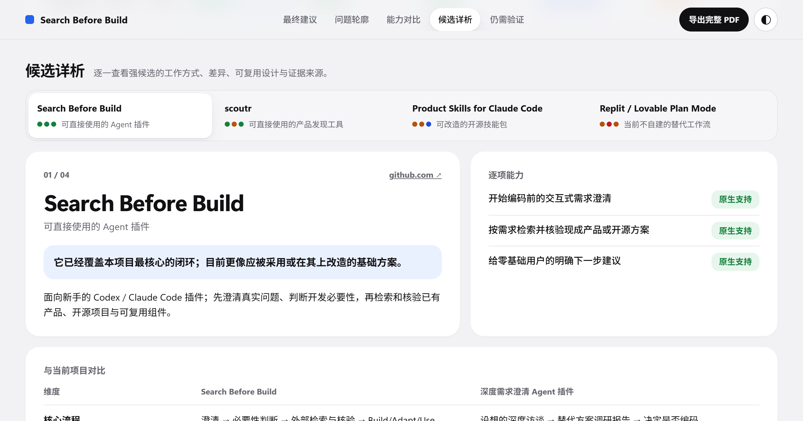
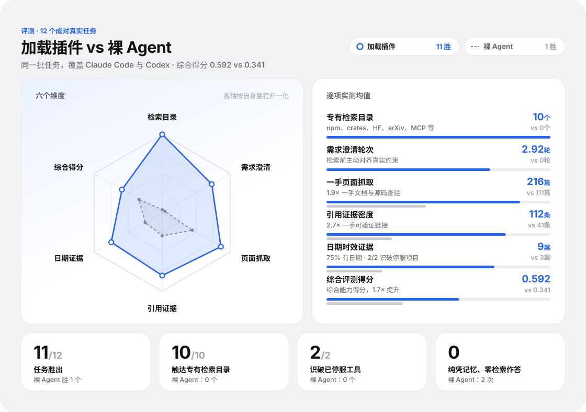

<div align="center">


# Search Before Build

**在开始 vibe coding 之前，先确认这东西真的值得做。**

一个面向 Claude Code、Codex、OpenCode 等支持技能的 Agent 的开工前调研插件：先帮你理清真实需求，再跨平台搜索、聚合相似项目与替代方案，并在你动手实现想法之前给出一份明确的建议——直接用现成的、基于现有方案改改，还是真的值得从头写。

[](https://www.npmjs.com/package/@superq/search-before-build)


[](./LICENSE)

[English](./README.md) | [简体中文](./README.zh-CN.md)

</div>

---

## 为什么做这个？

Vibe coding 让“有个想法”到“开始写代码”的距离变得非常短。这很爽，但也容易：为一次性问题搭一整套系统、写到一半才发现已有成熟产品、重复造轮子，最后花掉大量 token 得到一个自己也不会用的项目。

`search-before-build` 不打击想法，只是让你开工前多停几分钟，回答三个问题：

1. **你真正想解决的是什么？**
2. **这件事真的需要开发吗？**
3. **有没有现成方案可以直接用或拿来改？**

## 它怎么工作？

```text
一个模糊的想法
      │
      ▼
说清真实问题 ──→ 判断是否值得开发 ──→ 检索并验证现有方案
                                              │
                                              ▼
                         Build / Adapt / Use existing / Stop
```

最终给出一个明确但可由你覆盖的建议：

| 建议 | 含义 |
| --- | --- |
| **Build** | 需求真实，现有方案确实没覆盖关键缺口 |
| **Adapt** | 已有接近的方案，改造比从头开发更合适 |
| **Use existing** | 成熟方案已能解决主要问题，直接用更划算 |
| **Stop** | 需求证据不足，或开发成本明显高于收益 |

## 两个技能

| 技能 | 适用场景 | 用法 |
| --- | --- | --- |
| `assess` | 完整判断一个想法值不值得做，或者为已有工作寻找竞品和参考 | 先读你给的材料（仓库、文档、截图等），只追问材料里缺的关键信息（每次一问，最多五个），确认理解后再检索，给出建议和完整简报 |
| `quick-search` | 快速看看“有没有类似的东西” | 非必要不提问，查几个相关来源，直接在对话里列出最多五个候选，并给一句标明“初步”的看法 |

```text
/search-before-build:assess 我想做一个自动整理收藏内容的工具
/search-before-build:assess ./docs/plan.md
/search-before-build:quick-search 把 OpenAPI 文档转成 TypeScript 客户端的命令行工具
```

## 不只是搜索 GitHub

先看要找什么，再决定去哪里找。插件从需求中提取功能指纹，只选真正相关的来源，不会每次扫遍所有平台。

| 要找的东西 | 优先来源 |
| --- | --- |
| 开源仓库、源码或可复用实现 | GitHub |
| JS / Node.js 依赖、CLI 或插件 | npm |
| Python 库或工具（核对确切包名） | PyPI |
| 跨生态软件包信息与维护信号 | Ecosyste.ms Packages |
| Agent 可用的 MCP 工具或连接器 | Official MCP Registry |
| JVM（Java / Kotlin / Android）依赖 | Maven Central |
| Rust crate | crates.io |
| 模型、数据集或可复用 AI 应用 | Hugging Face Hub |
| 算法、论文或学术先例 | arXiv |

SaaS、商业产品、应用商店等不在目录中的方案，用网络搜索和官方页面补充。目标市场不明确时中英文同时检索。Stars、下载量只辅助判断成熟度，不代替功能匹配。

### 可选的 GitHub 深度检索

插件会自动查找你的 GitHub 工具；没有也能通过公开 API 和网页搜索正常运行。或者如果你同意，在 Claude Code 和 Codex 上，`assess` 也可自动安装 GitHub 官方 MCP：

```text
启用 GitHub 深度检索
```

安装器会下载并校验官方二进制，以 `repos` 工具集和 `--read-only` 模式运行，用浏览器 OAuth 登录且不额外申请权限范围。GitHub 只在内存中保存这次登录，所以每个新的 Agent 会话第一次搜索时会短暂打开 GitHub 页面；首次批准后通常无需再点确认。

## 临时研究简报

研究完成后，`assess` 会生成一份本地 HTML 可视化简报，集中展示最终建议、检索覆盖、能力矩阵、重点竞品、可复用经验和未知项。页面使用单文件离线渲染，不依赖 CDN，写入系统临时目录，因此不会因为一次随手询问就在当前项目中留下报告文件。

### 三步读懂一份研究简报

[体验完整报告样例](https://user-w-ui.github.io/search-before-build/zh/)

**1. 先看结论**

把真实需求、主要证据和剩余未知项汇总为一个明确建议，让你在投入开发之前先看清最值得复用的方向。

[](./assets/showcase/zh/01-decision.png)

**2. 再看能力矩阵**

只比较会影响选择的关键能力，用统一的支持标签呈现候选差异；证据不足时保留“尚未验证”，而不是猜测为不支持。

[](./assets/showcase/zh/02-capability-matrix.png)

**3. 最后深挖候选**

逐个查看采用成本、关键限制、值得关注的设计和可复用经验，并保留可追溯的官方来源。

[](./assets/showcase/zh/03-competitor-analysis.png)

每个竞品都提供“保存 Markdown”和“复制 Markdown”操作。只有你在看完结果后主动选择导出，或者明确要求插件持久化某个竞品时，才会形成长期报告：

```text
docs/search-before-build/<当前项目>/<竞品>.md
```

持久化报告继续保持一竞品一文件，只包含竞品简介、与当前项目的对比表、值得关注的设计、可复用启发、一句话总结和资料来源，不包含必要性判断或最终裁决。

## 安装与使用

**让 Agent 帮你装**

把下面这句话发给你正在用的 Agent（Claude Code、Codex、OpenCode、Pi 等）：

```text
读取 https://raw.githubusercontent.com/user-w-ui/search-before-build/main/INSTALL.md ，按里面的说明安装 Search Before Build。
```

也可以自己手动安装：

**Codex（一条命令）**

```bash
npx @superq/search-before-build install
```


**Codex（开发安装，跟随 `main`）**

```bash
codex plugin marketplace add user-w-ui/search-before-build --ref main
codex plugin add search-before-build@search-before-build
```

**Claude Code（marketplace）**

```text
/plugin marketplace add user-w-ui/search-before-build
/plugin install search-before-build@search-before-build
```

安装后即可调用 `/search-before-build:assess` 与 `/search-before-build:quick-search`；用 `/plugin marketplace update search-before-build` 更新。

**OpenCode（需要 v2 及以上）**

```bash
opencode plugin add github:user-w-ui/search-before-build
```

OpenCode 用 `@` 而不是 `/` 调用技能，例如 `@search-before-build-assess 我想做一个自动整理收藏内容的工具`。

**Pi**

```bash
pi install git:github.com/user-w-ui/search-before-build
```

**Cursor、GitHub Copilot、VS Code 等 Agent Plugins 客户端**

仓库根目录带有 [Agent Plugins](https://agent-plugins.org) 格式的 `plugin.json`，支持该格式的客户端可以直接安装这个仓库。

GitHub MCP 自动安装只支持 Claude Code 和 Codex；在其他宿主上，技能会复用你已有的 GitHub 工具，或退回公开 API 和网页搜索。

**验证插件**

```bash
npm test
npm run benchmark:offline
claude plugin validate --strict .
python tests/validate_plugin.py
```

## Benchmark

我们做了一组真实场景成对对比：12 个任务（9 个"要不要造"的想法 + 3 个已有项目评估），每个任务跑两遍——裸 agent 一遍、加载插件一遍——覆盖 Claude Code 与 Codex 两类宿主。完整数据与方法见 [`bench/results/SUMMARY.md`](./bench/results/SUMMARY.md)。

<div align="center">



</div>


## 致谢

- [WebVector](https://github.com/rthomas24/web-vector)：检索管线与排序融合的设计参考
- [pi-web-access](https://github.com/nicobailon/pi-web-access)：为 coding agent 打包 Web 访问能力的先例

## 参与贡献

欢迎提交 Issue 或 Pull Request，尤其欢迎：常被漏掉的检索平台、名称相似但功能不同的误匹配案例、能明显省时或省 token 的复用案例，以及对非专业用户仍太难理解的表达。

---

<div align="center">

### 三思而后行。

</div>
